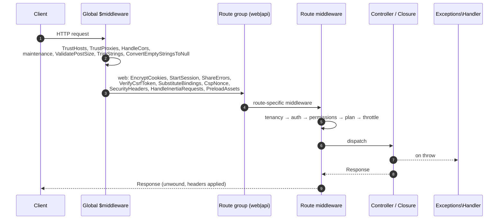
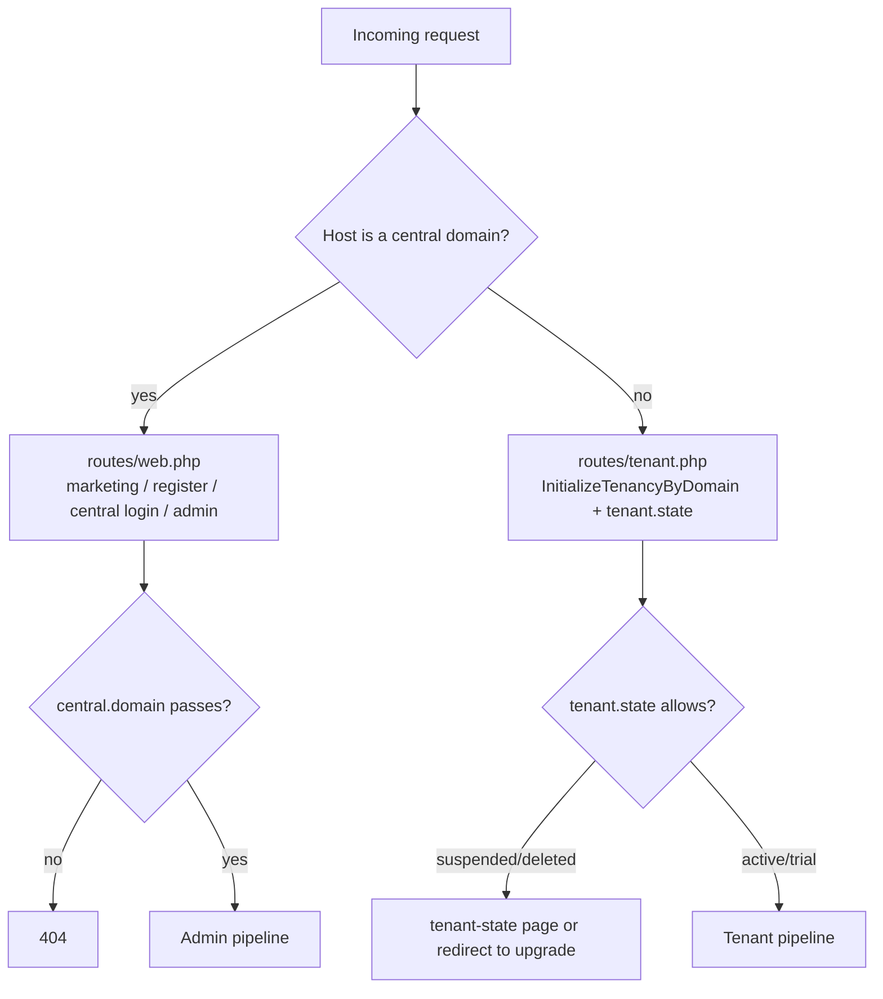

# 01 — Request Lifecycle

> **Scope**: how an HTTP request travels from the entry script, through the
> global and route middleware pipeline, to a controller, and back out as a
> response — including the central/tenant routing decision and Inertia vs JSON
> responses.
>
> **Out of scope**: what each controller *does* (module docs), and the details of
> tenancy initialisation (`03`) and auth (`04`).

---

## 1. Entry point

Every web/API request enters through `public/index.php`, which loads the
application built by [`bootstrap/app.php`](../../bootstrap/app.php) and hands it
to the HTTP kernel.

```
public/index.php
  └─ bootstrap/app.php           ← builds the Application, binds kernels
       └─ App\Http\Kernel        ← the HTTP kernel for this request
```

`bootstrap/app.php` binds three singletons: the **HTTP kernel**
(`App\Http\Kernel`), the **console kernel** (`App\Console\Kernel`) and the
**exception handler** (`App\Shared\Exceptions\Handler`).

---

## 2. Middleware pipeline

[`App\Http\Kernel`](../../app/Http/Kernel.php) runs middleware in **three
concentric layers**. Each layer wraps the next, and after the controller returns
the response unwinds back out through every layer (so e.g. `SecurityHeaders` can
stamp headers on the finished response).



### 2.1 Global middleware (`$middleware`)

Runs on **every** request, before routing:

| Middleware | Purpose |
|-----------|---------|
| `TrustHosts` / `TrustProxies` | Correct host/proxy resolution behind a load balancer |
| `HandleCors` | CORS headers |
| `PreventRequestsDuringMaintenance` | 503 during `down` |
| `ValidatePostSize` | Reject oversized bodies |
| `TrimStrings` → `ConvertEmptyStringsToNull` | Normalise input |

### 2.2 Route middleware groups (`$middlewareGroups`)

`RouteServiceProvider` loads the route files inside these groups.

**`web`** — cookies, session, CSRF, bindings, then the app's cross-cutting layer:

```
EncryptCookies → AddQueuedCookiesToResponse → StartSession → ShareErrorsFromSession
→ VerifyCsrfToken → SubstituteBindings
→ CspNonce → SecurityHeaders → HandleInertiaRequests → AddLinkHeadersForPreloadedAssets
```

- **`CspNonce`** generates a per-request nonce, registers it with Vite and shares
  it as `csp_nonce`.
- **`SecurityHeaders`** sets hardening headers on the way *out*; in production it
  emits a nonce-based CSP, in local/testing a dev CSP that allows the Vite server.
- **`HandleInertiaRequests`** shares `auth.user`, `impersonation`, `plan`,
  `feature_definitions` and `tenant_domain_suffix` with every Inertia response
  (plan data is cached per tenant, with a fallback for non-taggable stores).

**`api`** — `EnsureFrontendRequestsAreStateful` → `ThrottleRequests:api` →
`SubstituteBindings`.

### 2.3 Route middleware (aliases)

Aliases are declared on the kernel and applied per route. The important groups:

| Alias | Class | Role |
|-------|-------|------|
| `central.domain` | `EnsureCentralDomain` | 404 unless the host is a central domain |
| `auth:admin` / `auth` | `App\Http\Middleware\Authenticate` | Guard-based auth |
| `jwt.cookie` | `AuthenticateJwtFromCookie` | Copy the JWT cookie into an `Authorization: Bearer` header |
| `jwt.refresh` | `RefreshJwtToken` | Re-issue the JWT when it is expired or past half-TTL |
| `jwt.tenant` | `ValidateTenantToken` | Ensure the token's `ten` claim matches the current tenant |
| `session.expiry` | `EnsureSessionNotExpired` | Absolute session lifetime; guard-aware logout redirect |
| `impersonation.expiry` | `CheckImpersonationExpiry` | Clear an expired god-mode session |
| `impersonation.session` | `EnsureImpersonationValid` | Validate god mode, enforce read-only, inject identity |
| `tenant.state` | `CheckTenantState` | Gate tenant routes on lifecycle state (trial/suspended/deleted) |
| `feature` | `RequiresPlanFeature` | Gate a route on a plan feature |
| `storage.limit` | `CheckStorageLimit` | Reject writes that would exceed the plan's storage limit |
| `payment.rate.limit` | `PaymentMethodRateLimit` | Per-method/Action throttling for payment-method routes |
| `permission` / `role` | Spatie aliases (from `RouteServiceProvider`) | Permission/role gates |

Middleware **priority** matters: `TenancyServiceProvider` prepends tenancy
identification to the highest-priority list so the tenant is resolved before any
middleware that reads tenant data — see `03-multi-tenancy.md`.

---

## 3. Routing decision: central vs tenant

Routes are matched by **method + domain + URI**. Because central and tenant can
share a URI (`/`, `/register`), the central copies in `routes/web.php` are
registered **once per central domain** with an explicit domain constraint:

```php
foreach (config('tenancy.central_domains') as $centralDomain) {
    Route::domain($centralDomain)->middleware(['central.domain'])->get('/', …);
}
```



### Central admin pipeline

```php
['central.domain', 'jwt.cookie', 'jwt.refresh:admin', 'auth:admin',
 'throttle:100,1', 'session.expiry:admin', 'impersonation.expiry']
```

…then **per-route** `PermissionNames::middleware([...], 'admin')` gates. Central
routes never touch a tenant database.

### Tenant authenticated pipeline

```php
['jwt.cookie', 'impersonation.session', 'jwt.refresh:web', 'auth',
 'jwt.tenant:web', 'session.expiry:web', 'throttle:60,1']
```

…then `verified`, plus per-group `PermissionNames::middleware([...], 'web')`,
`feature:…` and `storage.limit` where relevant.

The whole tenant file is additionally wrapped in
`['web', InitializeTenancyByDomain, PreventAccessFromCentralDomains, 'tenant.state']`.

---

## 4. Dispatch and response

The controller (or route closure) runs and returns a response. Two common shapes:

- **Inertia** — `Inertia::render('Page', $props)`. Props are merged with the
  shared props from `HandleInertiaRequests`. On an Inertia visit the server
  returns JSON; on a full page load it renders the root Blade view (`app`).
- **JSON** — `response()->json(...)`, used by the admin SPA's `/admin/api/*`
  endpoints (distinguished from page routes by the `/api/` path segment).

The central login page is the one Blade view: `view('admin.login')`.

---

## 5. Exception handling

Unhandled exceptions pass to [`App\Shared\Exceptions\Handler`](../../app/Shared/Exceptions/Handler.php),
which normalises them into JSON for `expectsJson()` requests and redirects or
error pages otherwise. Domain-specific exceptions (e.g.
[`PlanLimitExceededException`](../../app/Shared/Exceptions/PlanLimitExceededException.php))
are rendered into the appropriate response shape.

---

## 6. Key decisions & invariants

- **Response headers are set on the way out.** `SecurityHeaders` wraps `$next`,
  so it must run early enough in the stack to still see the finished response.
- **The JWT cookie is a transport detail.** `jwt.cookie` promotes the cookie to an
  `Authorization` header so the rest of the stack only deals with bearer tokens.
- **`central.domain` runs first** in the admin groups so a non-central host is
  rejected with a 404 before auth/session work happens.
- **Tenancy middleware has highest priority** — tenant resolution precedes all
  tenant-data access.
- **Guests can reach the tenant root and reset flows**, but `tenant.state` still
  gates the group, so a suspended tenant cannot use even public routes.

---

## 7. Cross-references

- [`02-providers-and-container.md`](02-providers-and-container.md) — what is bound and when.
- [`03-multi-tenancy.md`](03-multi-tenancy.md) — how `InitializeTenancyByDomain` resolves a tenant.
- [`04-authentication.md`](04-authentication.md) — the JWT-cookie and session flows.
- [`05-permissions-and-plan-gating.md`](05-permissions-and-plan-gating.md) — the permission/feature middleware.
- Source: [`app/Http/Kernel.php`](../../app/Http/Kernel.php), [`routes/web.php`](../../routes/web.php), [`routes/tenant.php`](../../routes/tenant.php).
