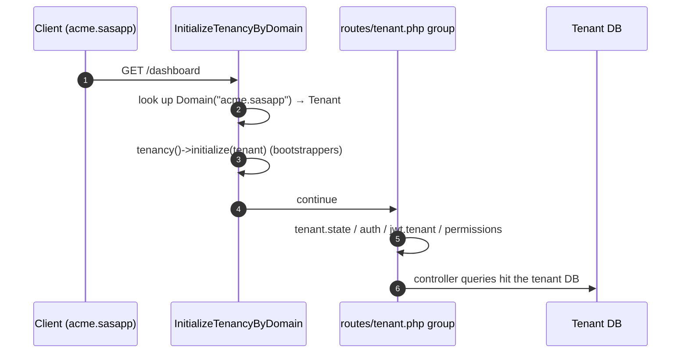
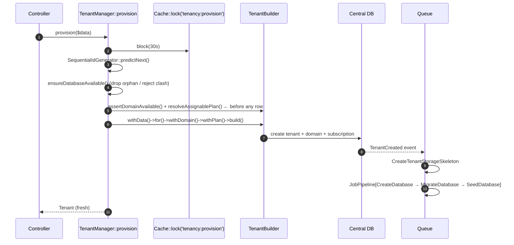
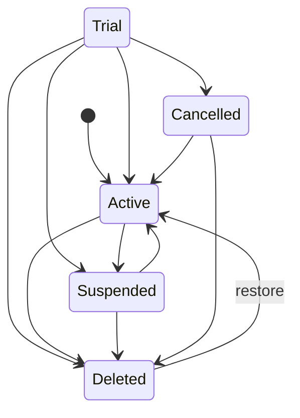

# 03 — Multi-Tenancy

> **Scope**: how the platform separates one tenant from another — the
> central/tenant split, the bootstrappers that make Laravel tenant-aware, how a
> request resolves its tenant, the provisioning pipeline, and the tenant
> lifecycle state machine.
>
> **Out of scope**: the HTTP middleware order (`01-request-lifecycle.md`), auth
> (`04`), and permissions scoping (`05`).

Powered by [`stancl/tenancy`](https://tenancyforlaravel.com) v3, **database per
tenant**, identified by **domain**.

---

## 1. Central vs tenant

There is one codebase and two contexts:

| | Central | Tenant |
|---|---------|--------|
| Host | a `config('tenancy.central_domains')` host | any non-central host (usually `<slug>.<tenant_domain_suffix>`) |
| Routes | `routes/web.php` (`central.domain` middleware) | `routes/tenant.php` (`InitializeTenancyByDomain`) |
| Database | the default `mysql` connection | a `tenant<id>` database |
| Auth guard | `admin` (JWT cookie) | `web` (session) |

In **local dev** both `mysql` and `mysql_central` point at the same database
(`config/database.php`), so connection switching is effectively a no-op;
`stancl` still runs its full bootstrap/revert cycle.

The tenant model, id generator and domain model are wired in
[`config/tenancy.php`](../../config/tenancy.php):

```php
'tenant_model' => App\Models\Tenant::class,          // :17
'id_generator' => SequentialIdGenerator::class,      // :18
'domain_model' => Domain::class,                     // :20
'central_domains' => explode(',', env('CENTRAL_DOMAINS', '127.0.0.1,localhost')), // :27
```

---

## 2. Bootstrappers — making Laravel tenant-aware

`tenancy()->initialize($tenant)` runs the bootstrappers listed at
`config/tenancy.php:51`:

```mermaid
flowchart LR
    A[tenancy()->initialize] --> B[DatabaseTenancyBootstrapper<br/>switch DB connection]
    B --> C[CacheTenancyBootstrapper<br/>tag cache keys tenant_id]
    C --> D[FilesystemTenancyBootstrapper<br/>suffix storage path]
    D --> E[QueueTenancyBootstrapper<br/>carry tenant on jobs]
```

- **DatabaseTenancyBootstrapper** — swaps the default connection to the tenant's
  `tenant<id>` database (`prefix` `tenant`, `suffix` `` at `:75`).
- **CacheTenancyBootstrapper** — prefixes every cache key with the tag base
  `tenant_` + tenant id (`:112`). Keep that literal in sync with the hand-written
  `'tenant_'.$id` tags used in `TenantStateManager::flushTenantCache()`.
- **FilesystemTenancyBootstrapper** — suffixes `storage_path()` and the `local`
  / `public` disks per tenant.
- **QueueTenancyBootstrapper** — makes queued jobs carry the tenant context.

`tenancy()->end()` runs `RevertToCentralContext`, unwinding the above.

> **Cache-manager hazard.** Never call `tenancy()->initialize()` only to flush a
> tenant that has already been dropped — `DatabaseTenancyBootstrapper` throws and
> the subsequent `end()` corrupts the cache manager. Flush tags directly:
> `Cache::tags(['tenant_'.$tenant->key])->flush()`. See
> [`TenantStateManager::flushTenantCache()`](../../app/Tenants/States/TenantStateManager.php) `:56`.

---

## 3. Tenant resolution on a request

Tenant routes are wrapped by `InitializeTenancyByDomain` (and
`PreventAccessFromCentralDomains`), which `TenancyServiceProvider` promotes to
the **highest middleware priority** so the tenant is known before any middleware
reads tenant data:



- [`TenancyServiceProvider::makeTenancyMiddlewareHighestPriority()`](../../app/Providers/TenancyServiceProvider.php) `:211`
  prepends the identification middleware in reverse so it ends up first.
- Then [`CheckTenantState`](../../app/Shared/Middleware/CheckTenantState.php) gates
  the group on the lifecycle state (see §6).
- A path-based identifier exists too (`InitializeTenancyByPath`) and is used in
  tests (`tests/Feature/Tenant/PathIdentificationTest.php`).

---

## 4. Provisioning a tenant

Provisioning is triggered by admin/signup controllers via
[`TenantManager::provision()`](../../app/Tenants/TenantManager.php) `:29`, then
completed **asynchronously** by a queued pipeline.



### 4.1 Validation before any row exists

[`TenantManager::provision()`](../../app/Tenants/TenantManager.php) `:29` allocates
the sequential id and validates the **domain** and **plan** *before* the tenant
row (and its queued pipeline) exists, so a rejected signup can never leave an
orphaned tenant or database behind:

- [`TenantBuilder::assertDomainAvailable()`](../../app/Tenants/Builders/TenantBuilder.php) `:72` — rejects a domain already used.
- [`TenantBuilder::resolveAssignablePlan()`](../../app/Tenants/Builders/TenantBuilder.php) `:105` — for public signup, refuses an inactive plan or a paid plan without a confirmed payment.
- If the builder still throws mid-way, the row is `forceDelete()`d.

### 4.2 Why the lock, and why not a singleton

- The `tenancy:provision` cache lock serialises **sequential id allocation**, held
  only across the row insert — not the whole queued pipeline.
- `TenantBuilder` is **bound, not singleton** (`TenantServiceProvider` `:43`):
  it is stateful, so a shared instance could leak one tenant's state into the
  next provision. `TenantManager` resolves a fresh builder per call.

### 4.3 The queued pipeline

`TenantCreated` fires [`TenancyServiceProvider::events()`](../../app/Providers/TenancyServiceProvider.php) `:67`:

1. `CreateTenantStorageSkeleton` (listener, runs inline).
2. A `JobPipeline` of `CreateDatabase → MigrateDatabase → SeedDatabase`, queued
   (`shouldBeQueued(true)`).

Migrations come from `database/migrations/tenant/` with `--step` per migration
(`config/tenancy.php:209`). Failures in stancl's jobs are logged by
`registerTenantJobFailureHandler()` `:234`.

**Deleting** only drops the database on a *force* delete; a soft delete keeps it
so the tenant can be restored (`events()` `:83`).

---

## 5. Tenant lifecycle state machine

The status is a small state machine implemented by
[`TenantStateManager`](../../app/Tenants/States/TenantStateManager.php) and the
[`TenantState`](../../app/Tenants/States/TenantState.php) subclasses.



[`transitionTo()`](../../app/Tenants/States/TenantStateManager.php) `:28` enforces
the table and fires side-effect events:

- → `Suspended` fires [`TenantSuspended`](../../app/Tenants/Events/TenantSuspended.php)
  → `HandleTenantSuspension`.
- → `Active` (from a non-active state) fires
  [`TenantReactivated`](../../app/Tenants/Events/TenantReactivated.php)
  → `HandleTenantReactivation` (flushes the tenant-scoped cache).

`TenantManager` wraps transitions with subscription bookkeeping:

| Method | Effect |
|--------|--------|
| [`suspend()`](../../app/Tenants/TenantManager.php) `:101` | cancel active subscription → `Suspended` |
| [`activate()`](../../app/Tenants/TenantManager.php) `:116` | reactivate most recent cancelled subscription → `Active` |
| [`delete()`](../../app/Tenants/TenantManager.php) `:135` | cancel subscription → `Deleted`, then soft-delete (DROPs the DB) |
| [`restore()`](../../app/Tenants/TenantManager.php) `:157` | reactivate/create subscription, ensure a domain, clear `deleted_at` → `Active` |
| [`changePlan()`](../../app/Tenants/TenantManager.php) `:230` | swap plan / enter-or-leave trial, fire `PlanChanged` |
| [`extendTrial()`](../../app/Tenants/TenantManager.php) `:333` | push `trial_ends_at` out by N days (Trial only) |

### Why the tricky ordering

- **`delete()` drops the DB *after* the transaction.** `$tenant->delete()` fires
  `TenantDeleted → DeleteDatabase` (MySQL DDL), and DDL implicitly commits — a
  DROP inside an open transaction makes PDO's `commit()` throw.
- **`restore()` validates *before* the transaction.** Under `RefreshDatabase`
  (a wrapping transaction), a throw inside a nested transaction corrupts the
  savepoint and masks the real `InvalidArgumentException`.
- **One `save()` per transaction.** Each `save()` fires `saved` →
  `InvalidatesResolverCache`, which may query other tables and self-deadlock
  against row locks held by the same transaction. `restore()` sets everything in
  memory and saves once; events fire *after* commit.

---

## 6. Gating routes on state

[`CheckTenantState`](../../app/Shared/Middleware/CheckTenantState.php) wraps the
whole tenant file:

- deleted/trashed → 403 (or the tenant-state page),
- expired trial → only the upgrade route, else redirect to upgrade,
- other non-active states → suspended response,
- active/trial → pass.

---

## 7. Tenant-aware building blocks

- **Jobs.** Extend [`TenantAwareJob`](../../app/Shared/Jobs/TenantAwareJob.php):
  `handle()` calls `tenancy()->initialize($tenant)`, runs `execute()`, and always
  `end()`s in a `finally` keyed on the package's `initialized` flag — so a
  bootstrapper failure on a long-lived worker cannot leak context into the next
  job.
- **Permissions.** Spatie caches permissions under one key;
  [`TenantAwarePermissionRegistrar`](../../app/Shared/Services/TenantAwarePermissionRegistrar.php)
  suffixes it with `_central` / `_tenant_<id>` so caches never cross tenants (see
  `05`).
- **Management.** [`TenantManager`](../../app/Tenants/TenantManager.php) is the
  façade; [`TenantServiceProvider`](../../app/Tenants/TenantServiceProvider.php)
  binds it (singleton) along with a cached repository and the per-call builder.

---

## 8. Key decisions & invariants

- **Database per tenant, identified by domain.** Central data never lives in a
  tenant database.
- **Validate before creating.** Domain/plan checks run before the tenant row so a
  rejected signup leaves nothing behind.
- **One builder per provision.** Never resolve `TenantBuilder` as a singleton.
- **State changes go through `TenantStateManager`.** No ad-hoc status writes.
- **Never `tenancy()->initialize()` just to flush a dropped tenant** — flush the
  `tenant_<id>` cache tag directly.
- **Events after commit; DDL outside the transaction.**

---

## 9. Cross-references

- [`01-request-lifecycle.md`](01-request-lifecycle.md) — where tenancy middleware sits in the pipeline.
- [`02-providers-and-container.md`](02-providers-and-container.md) — how `TenancyServiceProvider` and the module provider register.
- [`05-permissions-and-plan-gating.md`](05-permissions-and-plan-gating.md) — tenant-scoped permission cache.
- [`07-jobs-events-observers.md`](07-jobs-events-observers.md) — tenant-aware jobs in practice.
- Source: [`config/tenancy.php`](../../config/tenancy.php), [`app/Providers/TenancyServiceProvider.php`](../../app/Providers/TenancyServiceProvider.php), [`app/Tenants/`](../../app/Tenants/).
