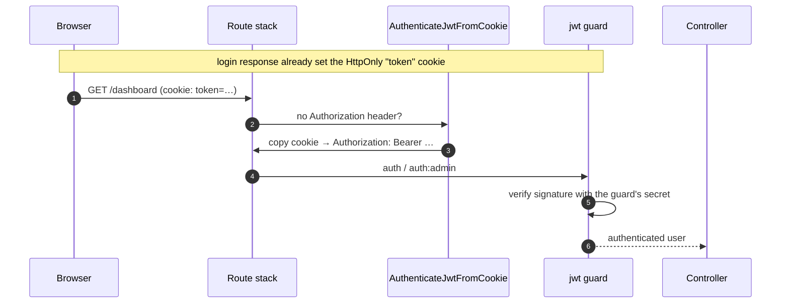
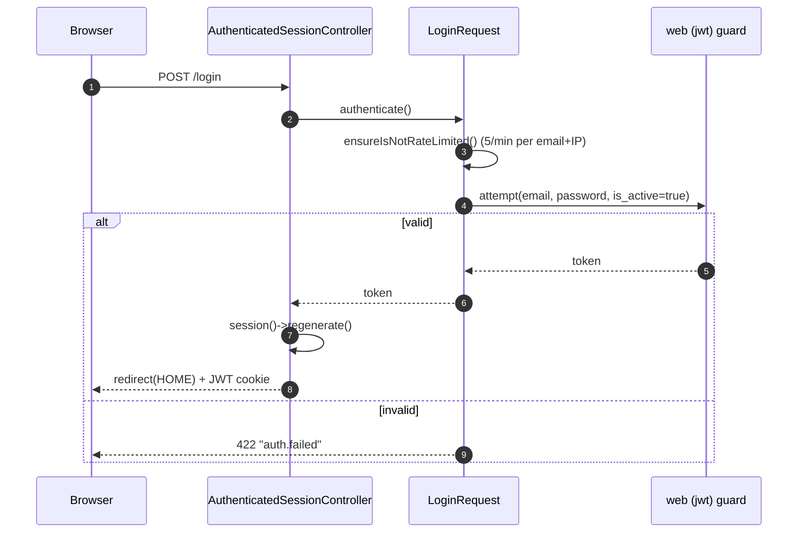
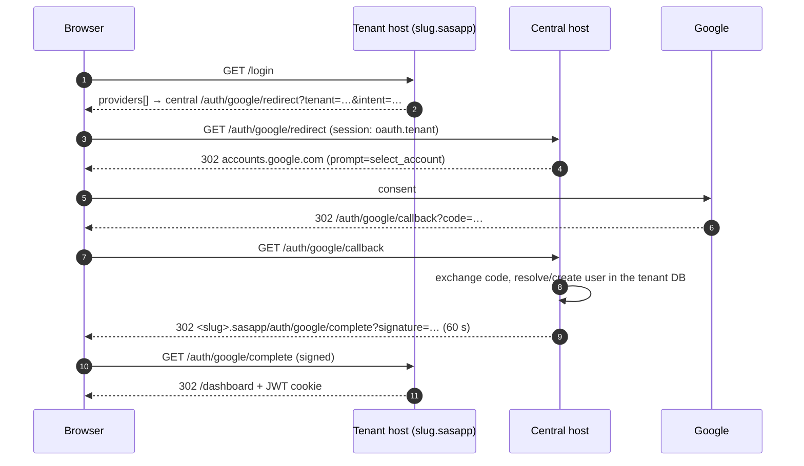
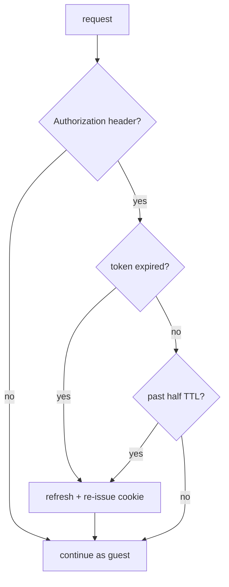

# 04 — Authentication

> **Scope**: how a user or admin is authenticated — the two JWT guards, the
> JWT-in-a-cookie transport, login rate limiting, token refresh, and the absolute
> session-lifetime check.
>
> **Out of scope**: authorization/permissions (`05`), god-mode impersonation
> (`06`), and the middleware ordering (`01`).

---

## 1. Two guards, one driver

Both guards use the **`jwt` driver** (`config/auth.php:41`):

| Guard | Provider | Secret | Used by |
|-------|----------|--------|---------|
| `web` | `App\Models\User` | `jwt.guard_secrets.web` → `JWT_SECRET` | tenant app |
| `admin` | `App\Models\AdminUser` | `jwt.guard_secrets.admin` → `JWT_ADMIN_SECRET` (falls back to `JWT_SECRET`) | central admin |

The **per-guard secret** is the isolation boundary: a token minted for a tenant
user is signed with a different key than an admin token, so it cannot be validated
by the other guard even if it is somehow presented
(`config/jwt.php:38`).

The `jwt` driver is registered by
[`JwtServiceProvider::boot()`](../../app/Shared/Providers/JwtServiceProvider.php) `:33`,
which resolves `jwt.guard_secrets.{guard}` and builds a `Manager` + `JWT` +
`JWTGuard` per guard.

---

## 2. The JWT-cookie transport

The token never lives in JavaScript-reachable storage: it is issued in an
**HttpOnly cookie** by [`JwtCookie`](../../app/Shared/Support/JwtCookie.php) and
promoted back to a bearer header on the next request.

- [`JwtCookie::make()`](../../app/Shared/Support/JwtCookie.php) `:21` — HttpOnly,
  `secure` from `session.secure`, `SameSite=Lax`, TTL `jwt.refresh_ttl`.
- [`JwtCookie::forget()`](../../app/Shared/Support/JwtCookie.php) `:37` — clears it.
- [`AuthenticateJwtFromCookie`](../../app/Shared/Middleware/AuthenticateJwtFromCookie.php)
  (alias `jwt.cookie`) copies the cookie into `Authorization: Bearer …` so the
  rest of the stack only deals with bearer tokens.
- [`RefreshJwtToken`](../../app/Shared/Middleware/RefreshJwtToken.php) (alias
  `jwt.refresh`) re-issues the cookie when the token is expired or past half-TTL.

---

## 3. Login flow

### 3.1 Tenant login

- [`AuthenticatedSessionController::store()`](../../app/Http/Controllers/Auth/AuthenticatedSessionController.php) `:48`.
- [`LoginRequest::authenticate()`](../../app/Http/Requests/Auth/LoginRequest.php) `:51`
  — throttles to **5 attempts / minute** keyed on `email|ip`,
  [`ensureIsNotRateLimited()`](../../app/Http/Requests/Auth/LoginRequest.php) `:75`.

### 3.2 Admin login

Same shape via
[`AdminAuthController::login()`](../../app/Shared/Http/Controllers/Admin/Auth/AdminAuthController.php) `:56`
and
[`AdminLoginRequest::authenticate()`](../../app/Http/Requests/Admin/AdminLoginRequest.php) `:36`,
but on the `admin` guard. One difference: a blocked account
(`is_active = false`) gets a distinct message rather than the generic
`auth.failed`, so support can tell the two apart — while an unknown email still
returns the generic message.

`AdminAuthController::user()` `:95` returns the admin plus the **flattened**
permission set (role permissions ∪ direct permissions), which the SPA uses to
render the menu. The login page itself is the one Blade view, `admin.login`
(`showLogin()` `:33`).

### 3.3 Tenant owner email confirmation (signup)

Login does **not** require a verified email: an unverified owner must be able to
sign in to reach the resend button. Instead, the `verified` middleware holds them
at `/verify-email` for everything below the verification routes.

The signed link itself is **self-contained**:
[`VerifyEmailController`](../../app/Http/Controllers/Auth/VerifyEmailController.php)
sits outside the `auth` group, looks the owner up by the `id` in the URL and
validates the signature in the controller. Mail clients open the link in whatever
browser is handy, so requiring a session pushed the owner through the login form
before the address was confirmed. The route still runs inside the tenant group,
so the lookup hits the tenant database; a signed link whose `hash` does not match
`sha1(email)` is refused.

The controller redirects to the signed central waiting screen `GET
/register/pending`, which renders `Auth/TenantRegisterSuccess` in its pending
state. That screen names the address, keeps the workspace locked, and has no link
into the workspace. Two things flip it to the green check:

1. **Reverb** — when the owner clicks the link, the `Verified` listener
   [`BroadcastTenantEmailVerified`](../../app/Tenants/Listeners/BroadcastTenantEmailVerified.php)
   projects `owner_email_verified_at` onto the central `tenants` row and
   broadcasts `TenantEmailVerified` on the public HMAC channel
   `tenant-verification.<sha256>`
   ([`TenantVerificationChannel`](../../app/Tenants/Support/TenantVerificationChannel.php)).
   The open tab is already subscribed through Echo, so it flips immediately.
2. **Poll fallback** — the screen still polls its own `verified` prop every five
   seconds, so it also flips when Reverb is not running.

`tenants.owner_email_verified_at` is a **projection**: the tenant-side
`users.email_verified_at` row remains authoritative, and only the owner's address
is projected — a teammate confirming their own address must not unlock the
owner's workspace. Real-time requires `BROADCAST_DRIVER=reverb` and a running
`php artisan reverb:start`; `php artisan reverb:install` generates the
`REVERB_*`/`VITE_REVERB_*` credentials. Without either, the poll keeps the flow
working.

The verified state shows the confirmation and a full-width **Go to Login**
button pointing at the tenant `/login`; it no longer auto-redirects, so the
owner chooses when to leave the screen (visiting the link again re-renders the
same confirmed state).
`Auth/EmailVerificationExpired` returns a 403 when the link is past its 60-minute
window, was tampered with, or points at a deleted account, and routes the owner
to sign in and resend. The in-tenant gate page `Auth/VerifyEmail` shows the
address the link went to, states that the workspace stays locked until it is
confirmed, and has no link into the workspace; resend and logout remain.

The pending screen and its resend action are **signed central URLs**
(`register.pending`, `register.pending.resend`, valid 24 hours): the owner has no
session yet, so the signature is the credential. Signup and paid checkout
redirect to the pending URL and start a server-side 60-second cooldown keyed by
tenant and normalised email. The screen's **Resend email** button posts the
signed resend URL and is disabled while that cooldown runs, so a reload, a second
tab, or a hand-crafted POST cannot send a stream of mails. The resend reuses
[`TenantVerificationMailer::send()`](../../app/Tenants/Support/TenantVerificationMailer.php),
so the initial mail and the resend share one template and one tenant-rooted
signed link.

Locally, the mail reaches Laragon's Mailpit when `.env` sets
`MAIL_MAILER=smtp` and `MAIL_HOST=127.0.0.1` (SMTP on port 1025, UI on 8025).
The signed links are rooted at `<slug>.sasapp`, so the Laragon Apache vhost must
also alias `*.sasapp`; otherwise the button falls through to the default docroot.

The central `/register` flow provisions the tenant and creates the owner through
[`CreateTenantAdminUser`](../../app/Tenants/Jobs/CreateTenantAdminUser.php) `:66`,
which fires `Registered` from inside `tenancy()->initialize()`. The owner is kept
**unverified** (`email_verified_at = null`), so the first dashboard request
redirects to `verification.notice` until the signed link is clicked.

The link must be rooted at the tenant domain: the provisioning job runs on a queue
worker with no tenant request, where `URL` would otherwise sign the central
`APP_URL`. [`TenantVerificationUrl::for()`](../../app/Tenants/Support/TenantVerificationUrl.php) `:34`
forces the URL root and scheme to the tenant's primary domain and restores both in
a `finally` (URL state is process-global and leaks into later jobs on a
long-lived worker). [`SendTenantVerificationEmail::handle()`](../../app/Tenants/Listeners/SendTenantVerificationEmail.php) `:23`
replaces the framework listener, so the in-tenant self-service signup shares the
same branded mail; send failures are logged and never fail provisioning.

### 3.4 Google OAuth (tenant login & registration)

Tenant users can sign in — or create an account — with Google instead of a
password. The flow is a **two-host handoff**: Google only accepts an exact
redirect URI, so a per-tenant callback (`<slug>.sasapp/...`) cannot be
registered (wildcards are rejected, and plain `http` is refused outside
loopback). Both OAuth endpoints therefore live on a **central** domain, and the
tenant is carried in the central session — never in the callback query string.
`GOOGLE_REDIRECT_URI` must be on the same host as `APP_URL`: that cookie is
host-scoped, so an entry link minted for `127.0.0.1` that returns to `localhost`
would lose the tenant and end in the "session expired" path.

- Entry point and callback:
  [`GoogleOAuthController::redirect()`](../../app/Http/Controllers/Auth/GoogleOAuthController.php) `:53`
  and [`GoogleOAuthController::callback()`](../../app/Http/Controllers/Auth/GoogleOAuthController.php) `:71`.
  Registered once as `oauth.google.redirect` / `oauth.google.callback` behind
  `central.domain` — `routes/web.php` :144. Deliberately **no `guest`**: these
  are central routes with no tenant session to protect, and `guest` would bounce
  a visitor who is already signed in instead of letting them switch accounts.
- Tenant end:
  [`GoogleOAuthCompleteController::__invoke()`](../../app/Http/Controllers/Auth/GoogleOAuthCompleteController.php) `:30`,
  route `auth.google.complete` with `signed` and `throttle:10,1`, outside both
  `auth` and `guest` — `routes/tenant.php` :112.
- Account resolution:
  [`OAuthAccountLinker::loginOrRegister()`](../../app/Shared/Support/OAuthAccountLinker.php) `:38`.
- Handoff URL:
  [`OAuthHandoffUrl::for()`](../../app/Tenants/Support/OAuthHandoffUrl.php) `:34`
  (`EXPIRY_SECONDS = 60`).

**Linking rules** (one `oauth_accounts` row per provider identity):

1. A known `provider` + `provider_user_id` signs in directly. Email is never
   consulted on this path, so an address change on either side cannot hijack the
   link.
2. An unknown identity may link to an existing local account **only when Google
   reports `email_verified`**. Linking an unverified provider email would let
   anyone who can create an unverified Google account for `victim@example.com`
   take over the victim's local account.
3. No local account → a user is created with `password = NULL`,
   `email_verified_at = now()` and `is_active = true`, subject to the plan's
   `max_users` quota (same `PlanLimitExceededException` as `StoreUserRequest`).
   `Registered` is **not** dispatched: its only listener sends the verification
   mail that Google has already made redundant.

Soft-deleted accounts are never resurrected — the Eloquent global scope keeps the
email lookup inside `deleted_at IS NULL`, matching the partial unique index.
Inactive accounts are refused on both paths, and every refusal returns to the
tenant host with a **signed** `?oauth_error=<code>` because a cross-host session
flash is unreadable on the other host
([`OAuthCallbackError`](../../app/Shared/Support/OAuthCallbackError.php) owns the
codes and the copy).

`users.password` is nullable for these accounts
(`2026_11_14_000002_make_users_password_nullable`). A NULL hash is not a bypass:
`BcryptHasher::check()` returns false for it, and the user can adopt a password
later through the profile / password-reset flows. The JWT is minted only on the
tenant host, so it never appears in a URL, and no provider access or refresh
tokens are stored.

Socialite does not implement the OAuth `state` parameter. The central session
binding (the tenant must be in *this* browser's session) plus
`prompt=select_account` — which forces the account chooser instead of a silent
SSO round trip — are what stand in for it; a login-CSRF would otherwise need the
victim to consent to the attacker's Google account unprompted.

---

## 4. Token refresh & expiry

[`RefreshJwtToken`](../../app/Shared/Middleware/RefreshJwtToken.php) refreshes on
either condition. The tenant claim `ten` is in `persistent_claims`
(`config/jwt.php:193`), so it survives a refresh and
[`ValidateTenantToken`](../../app/Shared/Middleware/ValidateTenantToken.php)
(`jwt.tenant`) can still reject a token that does not belong to the current
tenant.

**Absolute session lifetime.** Independently of the JWT TTL,
[`EnsureSessionNotExpired`](../../app/Shared/Middleware/EnsureSessionNotExpired.php)
(alias `session.expiry`) logs the guard out once
`now − last_activity` exceeds `session.absolute_lifetime`, returning a 401 (JSON)
or a **guard-aware redirect** — `central.login` for `admin`, `login` otherwise.

---

## 5. Middleware

| Alias | Class | Role |
|-------|-------|------|
| `jwt.cookie` | `AuthenticateJwtFromCookie` | cookie → bearer header |
| `jwt.refresh[:guard]` | `RefreshJwtToken` | sliding-window renewal |
| `auth` / `auth:admin` | `App\Http\Middleware\Authenticate` | guard check (401 for JSON/`/admin/*`) |
| `session.expiry[:guard]` | `EnsureSessionNotExpired` | absolute lifetime + guard-aware logout |
| `guest` | `RedirectIfAuthenticated` | keep authenticated users off guest pages |

---

## 6. Key decisions & invariants

- **Per-guard secrets are the isolation boundary** — never share a secret across
  guards in production.
- **Cookie is transport, bearer is the interface.** No middleware needs to know
  about cookies; `jwt.cookie` normalises.
- **Refresh keeps `ten`,** so tenant scoping survives renewal.
- **Rate limit by `email|ip`,** not by IP alone, so one attacker cannot lock out
  every account from a shared NAT.
- **Absolute lifetime is separate from TTL** so a long-lived refresh window still
  cannot extend a session indefinitely.

---

## 7. Cross-references

- [`01-request-lifecycle.md`](01-request-lifecycle.md) — where auth middleware runs.
- [`05-permissions-and-plan-gating.md`](05-permissions-and-plan-gating.md) — what the authenticated user may do.
- [`06-impersonation-god-mode.md`](06-impersonation-god-mode.md) — how an admin becomes a tenant user.
- [`03-multi-tenancy.md`](03-multi-tenancy.md) — the `ten` claim and tenant scoping.
- Source: [`config/auth.php`](../../config/auth.php), [`config/jwt.php`](../../config/jwt.php), [`JwtServiceProvider`](../../app/Shared/Providers/JwtServiceProvider.php), [`JwtCookie`](../../app/Shared/Support/JwtCookie.php).
