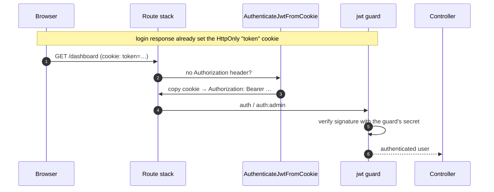
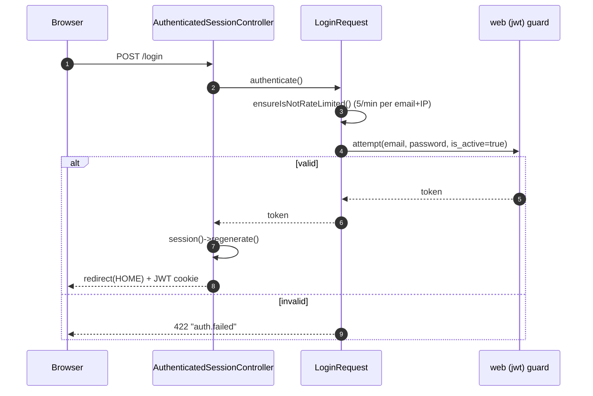
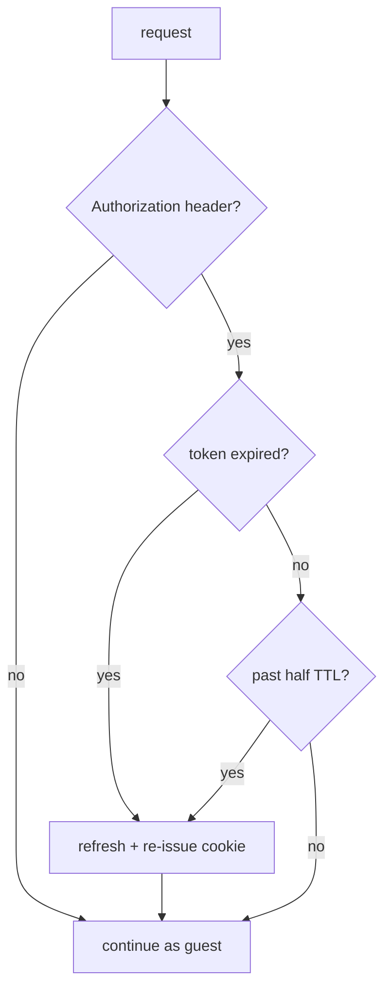

# 04 — Authentication

> **Scope**: how a user or admin is authenticated — the two JWT guards, the
> JWT-in-a-cookie transport, login rate limiting, token refresh, and the absolute
> session-lifetime check.
>
> **Out of scope**: authorization/permissions (`05`), god-mode impersonation
> (`06`), and the middleware ordering (`01`).

---

## 1. Two guards, one driver

Both guards use the **`jwt` driver** (`config/auth.php:41`):

| Guard | Provider | Secret | Used by |
|-------|----------|--------|---------|
| `web` | `App\Models\User` | `jwt.guard_secrets.web` → `JWT_SECRET` | tenant app |
| `admin` | `App\Models\AdminUser` | `jwt.guard_secrets.admin` → `JWT_ADMIN_SECRET` (falls back to `JWT_SECRET`) | central admin |

The **per-guard secret** is the isolation boundary: a token minted for a tenant
user is signed with a different key than an admin token, so it cannot be validated
by the other guard even if it is somehow presented
(`config/jwt.php:38`).

The `jwt` driver is registered by
[`JwtServiceProvider::boot()`](../../app/Shared/Providers/JwtServiceProvider.php) `:33`,
which resolves `jwt.guard_secrets.{guard}` and builds a `Manager` + `JWT` +
`JWTGuard` per guard.

---

## 2. The JWT-cookie transport

The token never lives in JavaScript-reachable storage: it is issued in an
**HttpOnly cookie** by [`JwtCookie`](../../app/Shared/Support/JwtCookie.php) and
promoted back to a bearer header on the next request.

- [`JwtCookie::make()`](../../app/Shared/Support/JwtCookie.php) `:21` — HttpOnly,
  `secure` from `session.secure`, `SameSite=Lax`, TTL `jwt.refresh_ttl`.
- [`JwtCookie::forget()`](../../app/Shared/Support/JwtCookie.php) `:37` — clears it.
- [`AuthenticateJwtFromCookie`](../../app/Shared/Middleware/AuthenticateJwtFromCookie.php)
  (alias `jwt.cookie`) copies the cookie into `Authorization: Bearer …` so the
  rest of the stack only deals with bearer tokens.
- [`RefreshJwtToken`](../../app/Shared/Middleware/RefreshJwtToken.php) (alias
  `jwt.refresh`) re-issues the cookie when the token is expired or past half-TTL.

---

## 3. Login flow

### 3.1 Tenant login

- [`AuthenticatedSessionController::store()`](../../app/Http/Controllers/Auth/AuthenticatedSessionController.php) `:42`.
- [`LoginRequest::authenticate()`](../../app/Http/Requests/Auth/LoginRequest.php) `:51`
  — throttles to **5 attempts / minute** keyed on `email|ip`,
  [`ensureIsNotRateLimited()`](../../app/Http/Requests/Auth/LoginRequest.php) `:75`.

### 3.2 Admin login

Same shape via
[`AdminAuthController::login()`](../../app/Shared/Http/Controllers/Admin/Auth/AdminAuthController.php) `:56`
and
[`AdminLoginRequest::authenticate()`](../../app/Http/Requests/Admin/AdminLoginRequest.php) `:36`,
but on the `admin` guard. One difference: a blocked account
(`is_active = false`) gets a distinct message rather than the generic
`auth.failed`, so support can tell the two apart — while an unknown email still
returns the generic message.

`AdminAuthController::user()` `:95` returns the admin plus the **flattened**
permission set (role permissions ∪ direct permissions), which the SPA uses to
render the menu. The login page itself is the one Blade view, `admin.login`
(`showLogin()` `:33`).

---

## 4. Token refresh & expiry

[`RefreshJwtToken`](../../app/Shared/Middleware/RefreshJwtToken.php) refreshes on
either condition. The tenant claim `ten` is in `persistent_claims`
(`config/jwt.php:193`), so it survives a refresh and
[`ValidateTenantToken`](../../app/Shared/Middleware/ValidateTenantToken.php)
(`jwt.tenant`) can still reject a token that does not belong to the current
tenant.

**Absolute session lifetime.** Independently of the JWT TTL,
[`EnsureSessionNotExpired`](../../app/Shared/Middleware/EnsureSessionNotExpired.php)
(alias `session.expiry`) logs the guard out once
`now − last_activity` exceeds `session.absolute_lifetime`, returning a 401 (JSON)
or a **guard-aware redirect** — `central.login` for `admin`, `login` otherwise.

---

## 5. Middleware

| Alias | Class | Role |
|-------|-------|------|
| `jwt.cookie` | `AuthenticateJwtFromCookie` | cookie → bearer header |
| `jwt.refresh[:guard]` | `RefreshJwtToken` | sliding-window renewal |
| `auth` / `auth:admin` | `App\Http\Middleware\Authenticate` | guard check (401 for JSON/`/admin/*`) |
| `session.expiry[:guard]` | `EnsureSessionNotExpired` | absolute lifetime + guard-aware logout |
| `guest` | `RedirectIfAuthenticated` | keep authenticated users off guest pages |

---

## 6. Key decisions & invariants

- **Per-guard secrets are the isolation boundary** — never share a secret across
  guards in production.
- **Cookie is transport, bearer is the interface.** No middleware needs to know
  about cookies; `jwt.cookie` normalises.
- **Refresh keeps `ten`,** so tenant scoping survives renewal.
- **Rate limit by `email|ip`,** not by IP alone, so one attacker cannot lock out
  every account from a shared NAT.
- **Absolute lifetime is separate from TTL** so a long-lived refresh window still
  cannot extend a session indefinitely.

---

## 7. Cross-references

- [`01-request-lifecycle.md`](01-request-lifecycle.md) — where auth middleware runs.
- [`05-permissions-and-plan-gating.md`](05-permissions-and-plan-gating.md) — what the authenticated user may do.
- [`06-impersonation-god-mode.md`](06-impersonation-god-mode.md) — how an admin becomes a tenant user.
- [`03-multi-tenancy.md`](03-multi-tenancy.md) — the `ten` claim and tenant scoping.
- Source: [`config/auth.php`](../../config/auth.php), [`config/jwt.php`](../../config/jwt.php), [`JwtServiceProvider`](../../app/Shared/Providers/JwtServiceProvider.php), [`JwtCookie`](../../app/Shared/Support/JwtCookie.php).
