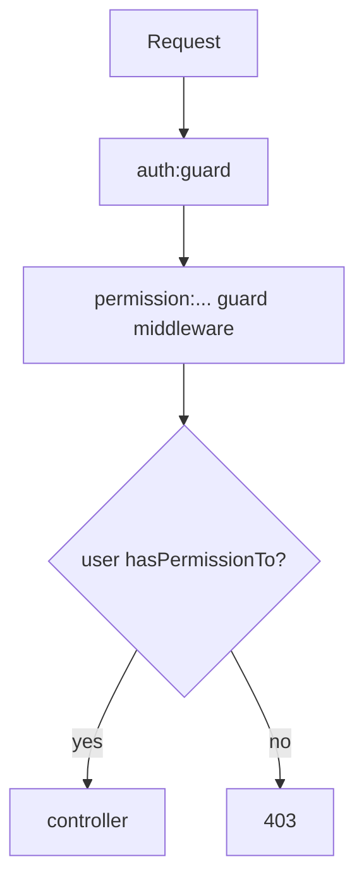
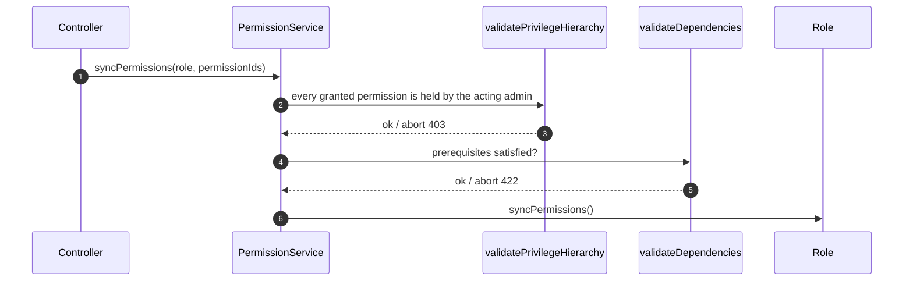
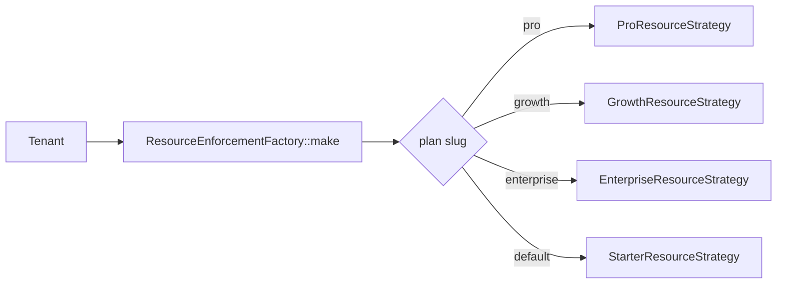

# 05 — Permissions & Plan Gating

> **Scope**: two independent gates — **who** a user is allowed to be (Spatie
> permissions) and **what** their tenant's plan allows (feature flags + resource
> limits).
>
> **Out of scope**: authentication (`04`), the tenant permission cache mechanics
> (`03`), and billing/payment flows.

---

## 1. Permissions (Spatie)

### 1.1 Catalog

All permission and role names live in one class,
[`PermissionNames`](../../app/Shared/Constants/PermissionNames.php), grouped by
area and guard. Central (admin) and tenant (web) catalogs are separate — the same
string may legally exist in both.

Route gating uses the Spatie middleware, built by a helper so names never drift:

```php
PermissionNames::middleware([PermissionNames::VIEW_TENANTS], 'admin')
// → "permission:view tenants,admin"
```

### 1.2 Route middleware

```php
Route::middleware(['auth:admin', PermissionNames::middleware([PermissionNames::VIEW_TENANTS], 'admin')])
```

Spatie's `permission:<a|b>,<guard>` middleware resolves the named guard and
checks the permission on the authenticated user. There are **no policy classes**
(`AuthServiceProvider` is intentionally empty) — authorization is entirely
route-middleware based.



### 1.3 Active-permission enforcement

Spatie matches permission *names* only, so a deactivated permission
(`is_active = false`) would still pass. [`EnforcesActivePermissions`](../../app/Shared/Traits/EnforcesActivePermissions.php)
aliases Spatie's `hasPermissionTo()` and short-circuits when the resolved
permission is inactive, so route middleware, `Gate::allows()` and `$user->can()`
all reject it.

### 1.4 Tenant-scoped permission cache

Spatie caches the permission tables under a single key.
[`TenantAwarePermissionRegistrar`](../../app/Shared/Services/TenantAwarePermissionRegistrar.php)
suffixes that key with `_central` or `_tenant_<id>`, and
`TenancyServiceProvider` clears the collection on every
`TenancyBootstrapped` / `RevertedToCentralContext`, so one context can never read
another's cached permissions.

### 1.5 Assignment rules

Writes go through [`PermissionService`](../../app/Shared/Services/PermissionService.php):



1. **Privilege hierarchy** — an admin may only grant permissions they hold
   themselves ([`validatePrivilegeHierarchy()`](../../app/Shared/Services/PermissionService.php) `:26`).
2. **Prerequisites** — dependent permissions require their prerequisites
   ([`validateDependencies()`](../../app/Shared/Services/PermissionService.php) `:43`),
   delegated to
   [`PermissionPrerequisiteValidator`](../../app/Shared/Services/PermissionPrerequisiteValidator.php):

   | Managed permission | Requires |
   |--------------------|----------|
   | `impersonate tenants` | `view tenants` |
   | `manage subscription payments` | `view tenants` |
   | `restore tenants` | `view tenants` |

   The map lives in
   [`PermissionPrerequisiteStrategyFactory::STRATEGY_MAP`](../../app/Shared/Factories/PermissionPrerequisiteStrategyFactory.php) `:12`;
   unmapped permissions use the no-op
   [`NullPrerequisiteStrategy`](../../app/Shared/Strategies/NullPrerequisiteStrategy.php).

---

## 2. Plan gating

Two flavours: **boolean features** and **numeric limits**.

### 2.1 Feature flags

A feature is a key in the `FeatureFlag` table. The catalog is read live by
[`FeatureFlagCatalog::definitions()`](../../app/Plans/Support/FeatureFlagCatalog.php) `:18`
(no caching, so admin edits apply immediately).

A plan enables features through its `featureGates` relation:

```php
$plan->hasFeature('advanced_reports');   // Plan.php:62
$tenant->hasFeature('advanced_reports'); // Tenant.php:179 → plan or false
```

`Plan::hasFeature()` uses the loaded relation when available, otherwise queries
`PlanFeature`. Legacy `plan_features` rows are migrated onto the canonical
registry by [`PlanFeatureNormalizer`](../../app/Plans/Support/PlanFeatureNormalizer.php).

**Route gate** — [`RequiresPlanFeature`](../../app/Shared/Middleware/RequiresPlanFeature.php)
(alias `feature:<key>`) returns 403 (JSON) / redirects to `billing.upgrade` when
the tenant lacks the feature.

### 2.2 Resource limits

Limits (`max_users`, `max_storage`, `max_warehouses`, `max_categories`,
`max_products`) are read via `Plan::getLimit()` `:75` /
`Tenant::getLimit()` `:184`, where `null` means unlimited (`PHP_INT_MAX`).

The **Strategy + Factory** pair keeps callers free of plan branching:



- [`ResourceEnforcementFactory::make()`](../../app/Billing/Factories/ResourceEnforcementFactory.php) `:17`
  resolves the tenant's plan (falling back to `tenancy.default_plan_slug`).
- Each strategy implements
  [`ResourceEnforcementInterface`](../../app/Billing/Contracts/ResourceEnforcementInterface.php)
  and also decides `allowedExportFormats()` (e.g. starter → `['csv']`).

**Write gate** — [`CheckStorageLimit`](../../app/Shared/Middleware/CheckStorageLimit.php)
(alias `storage.limit`) compares current usage + the requested size against
`maxStorageMb()` and throws
[`PlanLimitExceededException`](../../app/Shared/Exceptions/PlanLimitExceededException.php)
when exceeded.

---

## 3. Key decisions & invariants

- **No policies.** Authorization is route middleware + Spatie; `AuthServiceProvider`
  stays empty by design.
- **Permission names come from `PermissionNames`.** Build middleware with
  `PermissionNames::middleware()`, never hand-written strings.
- **Unknown/legacy permission deletions.** The seeder removes the deprecated
  coarse-grained `manage *` permissions.
- **Inactive permissions are dead permissions** everywhere, not just on routes.
- **Permissions are per-context cached** (`_central` / `_tenant_<id>`).
- **Plan gating is boolean OR numeric**, never a hard-coded plan check in a
  controller — use the factory/strategy.

---

## 4. Cross-references

- [`01-request-lifecycle.md`](01-request-lifecycle.md) — the `permission` / `feature` aliases in the pipeline.
- [`03-multi-tenancy.md`](03-multi-tenancy.md) — the tenant-aware permission registrar.
- [`04-authentication.md`](04-authentication.md) — the guards these permissions hang off.
- Source: [`PermissionNames`](../../app/Shared/Constants/PermissionNames.php), [`PermissionService`](../../app/Shared/Services/PermissionService.php), [`ResourceEnforcementFactory`](../../app/Billing/Factories/ResourceEnforcementFactory.php), [`FeatureFlagCatalog`](../../app/Plans/Support/FeatureFlagCatalog.php).
