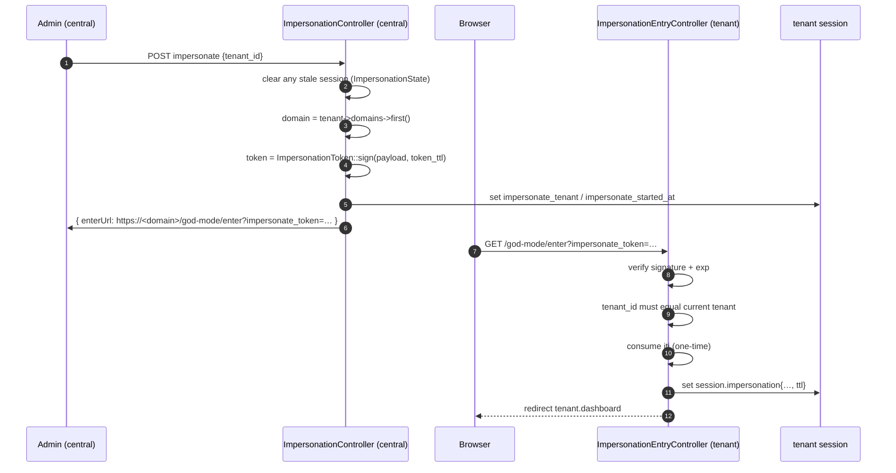
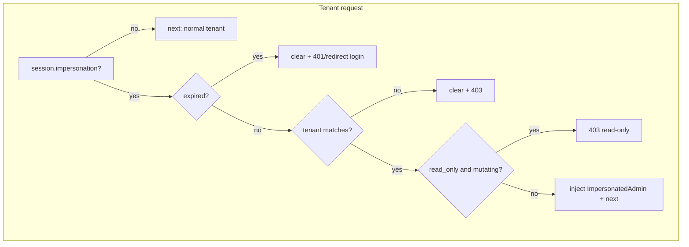

# 06 — Impersonation (God Mode)

> **Scope**: how a central admin temporarily enters a tenant's app in a
> read-only "god mode" session, the signed one-time handoff token, and the two
> guards that keep it safe.
>
> **Out of scope**: authentication (`04`) and permissions (`05`) — though god
> mode deliberately intersects both.

Config lives in [`config/impersonation.php`](../../config/impersonation.php):

| Key | Default | Meaning |
|-----|---------|---------|
| `token_ttl` | 300 (s) | lifetime of the **handoff token** (central → tenant) |
| `ttl` | 60 (min) | lifetime of the **active god-mode session** |
| `read_only` | `true` | block mutating requests while impersonating |

---

## 1. Two-phase handoff

Central and tenant are different domains, so the admin session cannot simply
"log in" on the tenant. Instead the admin app mints a **signed, single-use
token** and redirects the browser to the tenant's entry route.

### Phase 1 — start (central)

[`ImpersonationController::start()`](../../app/Shared/Http/Controllers/Admin/ImpersonationController.php) `:33`:

1. If a session is already active, clear it and log "replaced stale session".
2. Resolve the tenant's primary domain (422 if none).
3. Sign the handoff payload
   ([`ImpersonationToken::sign()`](../../app/Shared/Support/ImpersonationToken.php) `:24`)
   with `token_ttl`, then build the `enterUrl`.
4. Store the admin-side markers `impersonate_tenant` / `impersonate_started_at`
   in the session and write an activity-log entry.

### Phase 2 — enter (tenant)

[`ImpersonationEntryController::enter()`](../../app/Shared/Http/Controllers/Tenant/ImpersonationEntryController.php) `:32`:

1. If already in god mode here, redirect to the dashboard.
2. [`ImpersonationToken::verify()`](../../app/Shared/Support/ImpersonationToken.php) `:40`
   checks the HMAC signature and `exp` (403 if bad).
3. The payload's `tenant_id` must equal the tenant resolved from the current
   domain (403 otherwise).
4. **Single-use:** the token's `jti` is consumed via
   `Cache::store('global')->add('impersonate:used:'.$jti, …)`. The untagged
   `global` store is used because the token is issued centrally but validated in
   tenant context — a replay within the TTL is rejected.
5. Store `session.impersonation{admin_id, admin_name, admin_email, tenant_id, started_at, ttl}`
   and log "entered god mode".

---

## 2. Why the token is safe

[`ImpersonationToken`](../../app/Shared/Support/ImpersonationToken.php):

- **HMAC-SHA256** over the payload, keyed with the shared `APP_KEY` — only the
  same application can mint or validate it.
- Carries `iat`, `exp` and a random `jti`; `verify()` rejects on bad signature or
  expired `exp`.
- The `jti` makes it **one-time**: a captured URL cannot be replayed during its
  TTL.

---

## 3. The two guards

- **Tenant side** — [`EnsureImpersonationValid`](../../app/Shared/Middleware/EnsureImpersonationValid.php)
  (alias `impersonation.session`) `:36`: expires → clear + 401/redirect;
  tenant mismatch → clear + 403; read-only (`impersonation.read_only`) blocks any
  non-`GET/HEAD/OPTIONS` request except the explicit stop routes
  (`isReadOnly()` `:75`); then injects the synthetic identity.
- **Central side** — [`CheckImpersonationExpiry`](../../app/Shared/Middleware/CheckImpersonationExpiry.php)
  (alias `impersonation.expiry`) `:23`: mirrors the expiry check on the admin app
  so a stale marker never blocks the next start.

### The synthetic identity

[`ImpersonatedAdmin`](../../app/Shared/Support/ImpersonatedAdmin.php) implements
`Authenticatable` but is **not persisted** and is not a tenant user. It is
granted **every** tenant permission (`hasPermissionTo` → `true`, etc.) so
permission-gated tenant routes render — safety comes from the read-only guard,
not from withholding permissions. It is attached via
`Auth::guard('web')->setUser(...)` in `setImpersonatedAuth()` `:88`.

---

## 4. Exit

- **Tenant exit** — [`stop()`](../../app/Shared/Http/Controllers/Tenant/ImpersonationEntryController.php) `:84`:
  clears all impersonation keys and redirects to the first central domain.
- **Central exit** — [`ImpersonationController::stop()`](../../app/Shared/Http/Controllers/Admin/ImpersonationController.php) `:81`:
  just clears the session flags.

All flags are cleared together through
[`ImpersonationState::clear()`](../../app/Shared/Support/ImpersonationState.php) `:31`
(the single source of truth for the key list `:23`), preventing the admin-side
and tenant-side markers from drifting apart.

---

## 5. Key decisions & invariants

- **Never persist the impersonated identity.** `ImpersonatedAdmin` is transient.
- **Read-only is the safety mechanism,** enforced server-side on the method, not
  in the UI.
- **One-time token.** `jti` consumption is mandatory; the global cache store is
  intentional.
- **Clear both sides together.** Use `ImpersonationState`, never ad-hoc
  `session()->forget(...)`.
- **Every transition is logged** under the `impersonation` activity channel.

---

## 6. Cross-references

- [`04-authentication.md`](04-authentication.md) — the guards god mode sits on top of.
- [`05-permissions-and-plan-gating.md`](05-permissions-and-plan-gating.md) — why the synthetic identity is granted all permissions.
- [`01-request-lifecycle.md`](01-request-lifecycle.md) — where the impersonation middleware runs.
- Source: [`ImpersonationController`](../../app/Shared/Http/Controllers/Admin/ImpersonationController.php), [`ImpersonationEntryController`](../../app/Shared/Http/Controllers/Tenant/ImpersonationEntryController.php), [`ImpersonationToken`](../../app/Shared/Support/ImpersonationToken.php), [`ImpersonationState`](../../app/Shared/Support/ImpersonationState.php), [`ImpersonatedAdmin`](../../app/Shared/Support/ImpersonatedAdmin.php).
