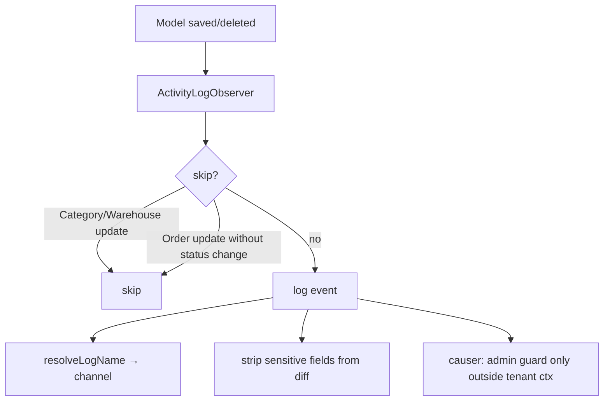
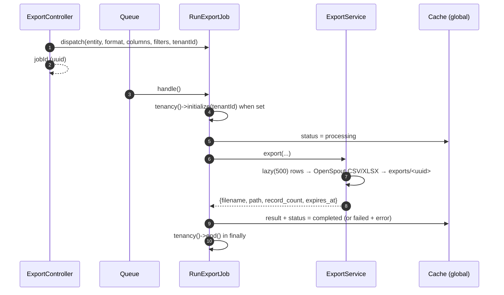

# 07 — Jobs, Events & Observers

> **Scope**: the asynchronous and reactive layer — queued jobs (tenant-aware and
> central), the export pipeline, event→listener wiring, and the model observers
> that keep the activity log and resource-usage counters in sync.
>
> **Out of scope**: tenancy bootstrapping (`03`), billing flows, and the console
> schedule (`08`).

---

## 1. Model observers

Observers are registered in
[`EventServiceProvider::boot()`](../../app/Providers/EventServiceProvider.php) `:66`.
Event auto-discovery is **off** (`shouldDiscoverEvents()` `:124`) — every observer
is explicit.

### 1.1 Activity log

Every central and tenant model is observed by
[`ActivityLogObserver`](../../app/Shared/Observers/ActivityLogObserver.php),
which writes create/update/delete/restore events to the Spatie activity log.

- `updated()` skips noisy models (`Category`, `Warehouse`) and Order updates that
  don't change `status` (`:29`).
- Diffs exclude `password`, `remember_token`, `api_key`, `secret_key` (`:22`).
- **Causer resolution** (`:95`): the `admin` guard is only queried when
  `! tenancy()->initialized` — inside a tenant request the `admin_users` table
  does not exist on the tenant connection, so it falls back to `auth()->user()`.

### 1.2 Resource-usage counters

Tenant resource models are also observed by the `App\Observers\Tenant\*`
observers, which keep [`TenantResourceUsage`](../../app/Models/TenantResourceUsage.php)
counters incremental (no COUNT queries on the hot path):

| Observer | Counter |
|----------|---------|
| [`UserObserver`](../../app/Observers/Tenant/UserObserver.php) | `users_count` |
| [`ProductObserver`](../../app/Observers/Tenant/ProductObserver.php) | `products_count` |
| [`OrderObserver`](../../app/Observers/Tenant/OrderObserver.php) | `orders_count` |
| [`ProductImageObserver`](../../app/Observers/Tenant/ProductImageObserver.php) | `storage_kb` |
| [`CategoryObserver`](../../app/Observers/Tenant/CategoryObserver.php) | `categories_count` |
| [`WarehouseObserver`](../../app/Observers/Tenant/WarehouseObserver.php) | `warehouses_count` |

Every observer **no-ops outside tenant context** (`tenant('id') === null`).
[`ProductObserver::deleted()`](../../app/Observers/Tenant/ProductObserver.php) `:35`
guards against double-decrementing on force-delete of an already soft-deleted
product.

---

## 2. Events & listeners

| Event | Listener(s) | Registered in |
|-------|-------------|---------------|
| `Registered` | `SendEmailVerificationNotification` | `EventServiceProvider::$listen` |
| `PlanChanged` | `HandlePlanChange` | billing provider |
| `TenantSuspended` | `HandleTenantSuspension` | `TenancyServiceProvider` |
| `TenantReactivated` | `HandleTenantReactivation` | `TenancyServiceProvider` |
| stancl tenancy events | bootstrap/revert + provisioning pipeline | `TenancyServiceProvider` (see `03`) |

- [`HandlePlanChange`](../../app/Billing/Listeners/HandlePlanChange.php) `:23`
  classifies the change as upgrade/downgrade, and on a **downgrade** re-counts the
  affected resources (initialising tenancy to count inside the tenant DB) and
  notifies the tenant when limits are exceeded or features are lost.
- [`HandleTenantSuspension`](../../app/Tenants/Listeners/HandleTenantSuspension.php) `:14`
  and
  [`HandleTenantReactivation`](../../app/Tenants/Listeners/HandleTenantReactivation.php) `:14`
  flush the tenant's cache tags (tolerating non-taggable stores).
- [`CreateTenantStorageSkeleton`](../../app/Tenants/Listeners/CreateTenantStorageSkeleton.php) `:13`
  creates the tenant's storage directories on `TenantCreated`.

---

## 3. Queue jobs

### 3.1 Tenant-aware jobs

Anything that must run inside a tenant's context extends
[`TenantAwareJob`](../../app/Shared/Jobs/TenantAwareJob.php) (see
[`03-multi-tenancy.md`](03-multi-tenancy.md) §7): `handle()` initialises tenancy,
runs `execute()`, and always ends tenancy in a `finally` keyed on the package's
`initialized` flag so a bootstrapper failure cannot leak context into the next
job on a long-lived worker.

### 3.2 Export pipeline

Exports are heavy enough to run off-request:

- [`RunExportJob`](../../app/Shared/Jobs/RunExportJob.php) `:28` carries a unique
  `jobId` and a 300s timeout. Status/progress live in the **untagged `global`**
  cache store (`:63`) so they can be read from either central or tenant context.
- [`ExportService`](../../app/Shared/Services/ExportService.php) `:32` streams each
  entity with `lazy(500)`, caps the row count per entity (`MAX_RECORDS` `:36`),
  and writes via OpenSpout. Files expire after 24h (`EXPIRY_HOURS` `:34`) and are
  removed by `cleanupExpired()`.

> **Cross-tenant safety.** RunExportJob keys its cache entries by
> `tenant:{id}:export` when a tenant is present, so two tenants never share a
> result slot.

---

## 4. Key decisions & invariants

- **Observers are explicit, not auto-discovered** — auditability beats magic.
- **Counters are incremental**, never recomputed by COUNT on the request path.
- **Observers no-op outside tenant context** so central operations don't corrupt
  per-tenant counters.
- **Causer resolution is tenancy-aware** — never query `admin_users` in a tenant
  context.
- **Job status uses the `global` cache store** (untagged), since it is written in
  one context and read in another.
- **Sensitive fields never reach the log.**

---

## 5. Cross-references

- [`03-multi-tenancy.md`](03-multi-tenancy.md) — `TenantAwareJob` and the provisioning pipeline.
- [`05-permissions-and-plan-gating.md`](05-permissions-and-plan-gating.md) — the limits `HandlePlanChange` checks.
- [`08-console-and-scheduled.md`](08-console-and-scheduled.md) — commands that dispatch these jobs.
- Source: [`EventServiceProvider`](../../app/Providers/EventServiceProvider.php), [`ActivityLogObserver`](../../app/Shared/Observers/ActivityLogObserver.php), [`RunExportJob`](../../app/Shared/Jobs/RunExportJob.php), [`ExportService`](../../app/Shared/Services/ExportService.php).
