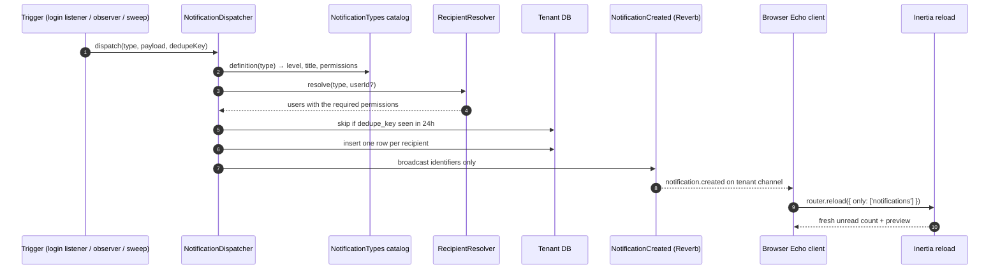

# 09 — In-App Notifications

> **Scope**: the three v1 notification types (passwordless account, low stock,
> unusually large order), their recipients and thresholds, the dispatcher, the
> Reverb-only delivery path and the HTTP/Inertia surface.
>
> **Out of scope**: email/SMS delivery (not built in v1), the tenant provisioning
> flow (`03`), and the general command schedule (`08`).

---

## 1. Flow

1. A trigger — a login listener, a model observer or the sweep job — calls
   [`NotificationDispatcher::dispatch()`](../../app/Shared/Notifications/NotificationDispatcher.php) `:35`.
   All writes go through this single path; no controller or observer inserts a
   `notifications` row directly.
2. The level and title come from [`NotificationTypes::definition()`](../../app/Shared/Constants/NotificationTypes.php) `:69`.
   The catalog also declares the permissions required to receive each type, so
   recipients follow the same Spatie grants that gate the underlying screens.
3. [`RecipientResolver::resolve()`](../../app/Shared/Notifications/RecipientResolver.php) `:22`
   returns either one explicitly addressed user (passwordless account) or every
   user holding any declared permission **that exists in the tenant permission
   table**. Bare or partially seeded tenants simply yield no recipients instead
   of failing the triggering business action.
4. [`NotificationDispatcher::alreadyNotified()`](../../app/Shared/Notifications/NotificationDispatcher.php) `:67`
   suppresses a repeat of the same `(user, type, dedupe_key)` inside 24 hours.
5. One row is inserted per recipient, their cached unread count is forgotten,
   and [`NotificationCreated::broadcastWith()`](../../app/Shared/Events/NotificationCreated.php) `:45`
   publishes only `id`, `type` and `level`.
6. The browser subscribes to the private channel from
   [`NotificationCreated::broadcastOn()`](../../app/Shared/Events/NotificationCreated.php) `:34`
   and refreshes the shared `notifications` prop; event payloads are never
   rendered.

---

## 2. Triggers

| Type | Trigger | Recipients |
|------|---------|------------|
| `password_not_set` | tenant `web` login with `password = null` (typically Google sign-in), or nightly sweep | that user |
| `low_stock` | new inventory movement, or nightly sweep | `manage inventory` / `manage products` |
| `large_order` | new order above the absolute threshold or a multiple of the 30-day average | `manage orders` / `manage payments` |

- [`NotifyPasswordlessUserOnLogin::handle()`](../../app/Shared/Notifications/NotifyPasswordlessUserOnLogin.php) `:25`
  listens for tenant-user `Login` events and targets passwordless users — in
  practice the Google handoff. JWTGuard reports `tymon.jwt` for both guards, so
  the user model class identifies tenant users. It uses `password:<id>`, the
  same key as the sweep, so both paths share the 24-hour dedupe. `Authenticated`
  is deliberately not used because the JWT guard fires it on every token parse.
- [`InventoryMovementObserver::created()`](../../app/Observers/Tenant/InventoryMovementObserver.php) `:21`
  compares the current stock with [`StockLevels::effectiveThreshold()`](../../app/Shared/Support/StockLevels.php) `:34`
  (per-product override → tenant setting → default 10) and uses `product:<id>`
  as the dedupe key.
- [`OrderObserver::notifyIfLarge()`](../../app/Observers/Tenant/OrderObserver.php) `:41`
  skips backfilled orders older than five minutes. The absolute threshold of
  zero disables that rule; the multiplier rule still applies.
- [`ScanTenantNotifications::execute()`](../../app/Shared/Jobs/ScanTenantNotifications.php) `:21`
  covers conditions that events cannot catch — a passwordless account that has
  not signed in again, and stock that became low because an admin lowered a
  threshold. It is dispatched by
  [`ScanNotificationTriggersCommand::handle()`](../../app/Shared/Console/Commands/ScanNotificationTriggersCommand.php) `:24`
  daily. Re-running is a no-op thanks to the dedupe keys.

---

## 3. HTTP and UI surface

- `GET /notifications` renders `Tenant/Notifications/Index` with the current
  user's rows paginated (15 per page). `PATCH /notifications/{notification}`
  returns **403** unless the row belongs to the authenticated user;
  `POST /notifications/read-all` only updates that user's unread rows.
- [`NotificationController::markRead()`](../../app/Shared/Http/Controllers/Tenant/NotificationController.php) `:30`
  is the ownership gate — there are no policy classes in this project, so the
  check lives in the controller.
- `GET/PUT /notifications/settings` are gated by the `manage settings`
  permission, matching the threshold form in `Pages/Tenant/Notifications/Settings`.
  Per-product overrides are edited in `Pages/Tenant/Products/Form`.
- [`HandleInertiaRequests::notificationData()`](../../app/Shared/Middleware/HandleInertiaRequests.php) `:85`
  shares a scoped unread count and five-item preview on every response. Guests,
  central requests and impersonated sessions receive an empty payload, and the
  `notification_channel` prop is `null` for impersonators.

---

## 4. Key decisions & invariants

- **Notification-only v1.** Reverb failures are logged and swallowed in the
  dispatcher: a stopped socket server must never fail a stock movement or an
  order.
- **Identifiers over the socket.** Content is re-fetched through an
  authenticated Inertia request, so no tenant text rides the broadcast.
- **Private channel, tenant-scoped.** `/broadcasting/auth` runs the same tenant
  middleware stack as application routes and compares the tenant key in the
  channel name with the initialized tenant.
- **Server-owned read state.** Only authenticated writes can change `read_at`;
  the client never optimistically marks a row read.
- **No polling.** The browser relies on Echo and `router.reload`; there is no
  periodic unread-count endpoint.

---

## 5. Cross-references

- [`07-jobs-events-observers.md`](07-jobs-events-observers.md) — observer registration and `TenantAwareJob`.
- [`08-console-and-scheduled.md`](08-console-and-scheduled.md) — the daily scan command.
- [`05-permissions-and-plan-gating.md`](05-permissions-and-plan-gating.md) — the permission names used by the recipient resolver.
