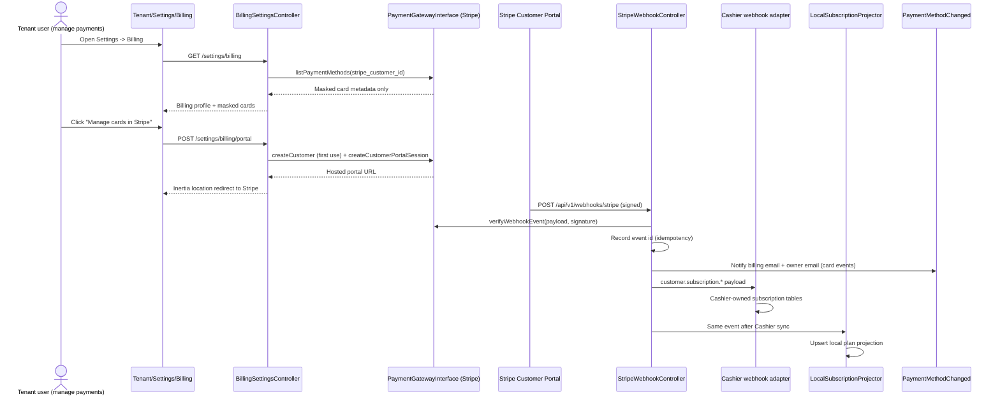

# Billing settings and Stripe card management

## Scope

Covers the tenant-facing Billing settings page, the Stripe Customer Portal
handoff, the central webhook that sends card-change confirmation emails, and
the Cashier-backed sync of Stripe subscription state into the local plan
projection. It does **not** cover plan checkout, subscription invoices, or the
admin gateway/API-key configuration screen.

## Flow

## Step-by-step

1. The Billing card appears in the settings hub only for users holding the
   `manage payments` permission; the same permission guards every billing
   route. No new permission was introduced.
2. Billing details are saved on the central `tenants` row. The personal profile
   form still writes to the tenant database user row, so the owner's login
   email is never changed by a billing edit.
3. When a billing email change is saved for a tenant that already has a Stripe
   customer, the adapter updates the Stripe customer email. A failed Stripe
   update returns an error and does not persist the local change.
4. On the first portal visit, the app creates a Stripe customer with tenant
   metadata and stores only its id in `tenants.stripe_customer_id`. No card
   number, expiry, or CVC is ever collected or stored by the app.
5. The portal session URL is short-lived and Stripe-hosted. The return URL is
   generated per request, so it carries the current tenant host.
6. Stripe posts signed `payment_method.attached`, `payment_method.detached`,
   and `customer.updated` events to the central webhook. `customer.updated`
   only produces an email when the default payment method actually changes.
7. The webhook verifies the signature, records the Stripe event id in
   `stripe_webhook_events`, and resolves the tenant by
   `stripe_customer_id`. Retried deliveries are acknowledged without a second
   notification.
8. One on-demand `PaymentMethodChanged` notification is routed to both the
   billing email and the owner email. Its content contains only masked card
   metadata.
 9. Subscription events are passed to Cashier's own webhook handler first, then
    to `LocalSubscriptionProjector`. If either step throws, the ledger row is
    deleted and the webhook returns 500 so Stripe can retry.

## Cashier Phase 1 — foundation (expand-only)

Laravel Cashier is installed but the request path above is unchanged in this
phase. The goal is compatibility: app code still reads and writes
`tenants.stripe_customer_id`, while Cashier-specific models and columns are
introduced without dropping or renaming anything yet.

- `config/cashier.php` maps Cashier's `key`/`secret` to the app's existing
  `STRIPE_PUBLISHABLE_KEY` / `STRIPE_SECRET_KEY` env names, with Cashier's
  upstream defaults as fallbacks. The webhook secret and endpoint remain the
  app's own.
- `BillingServiceProvider` registers `BillingCustomer` as the Cashier billable
  model, custom central `CashierSubscription` / `CashierSubscriptionItem`
  models, and `Cashier::ignoreRoutes()` so Cashier does not add a competing
  `/stripe/webhook` route.
- `BillingCustomer` maps the central `tenants` row. A separate billable view is
  required because `Tenant::subscriptions()` is the local plan/entitlement
  projection and Cashier's `Billable` trait defines a method with the same name.
- Phase 1 adds `tenants.stripe_id`, `pm_type`, `pm_last_four`, and
  `registration_trial_ends_at`; `stripe_id` is a case-sensitive backfill of
  `stripe_customer_id`. Model hooks on both `Tenant` and `BillingCustomer`
  mirror Stripe-id writes in either direction. The legacy column is still
  authoritative until the contract migration in a later phase.
- Stripe subscription state lives in `cashier_subscriptions` and
  `cashier_subscription_items` on the central connection. They are separate
  from the existing `subscriptions` table, which remains the local projection.
- Cashier registration is additive: no new permission, no raw card data, and no
  user-visible flow changes. `CashierIntegrationTest` plus the existing billing,
  webhook, model-connection, and up/down migration tests guard this phase.

## Cashier Phase 2 — subscription webhook sync

The central webhook now handles the full Stripe event for
`customer.subscription.created`, `customer.subscription.updated`, and
`customer.subscription.deleted`:

- `CashierSubscriptionWebhookAdapter` feeds the verified payload into Cashier's
  own public webhook handler, so Cashier remains the owner of
  `cashier_subscriptions` and `cashier_subscription_items`. No package code is
  forked and no second webhook route is registered.
- `plans.stripe_price_id` maps a Stripe recurring price to the local plan.
  `subscriptions.stripe_subscription_id` keys the local projection row, so
  retries upsert one row instead of inserting duplicates.
- `LocalSubscriptionProjector` maps Stripe statuses to local ones:
  `active` → `active`, `trialing` → `trial`, `past_due`/`incomplete`/`paused` →
  `pending`, `canceled`/`unpaid` → `cancelled`, and `incomplete_expired` →
  `expired`. Active or trialing events update `tenants.plan_id`, flush the
  tenant cache through `TenantLifecycleInterface`, and dispatch `PlanChanged`.
- Cancellation marks the local subscription cancelled but deliberately leaves
  `tenants.plan_id` unchanged. Reverting entitlement is an explicit downgrade
  policy, not a silent side effect of a Stripe webhook.
- Unknown customers and unmapped prices are ignored with a warning; Cashier
  state may still be recorded, but no local entitlement is created.
- If Cashier or the projector throws, the webhook ledger row is deleted and the
  endpoint returns 500 so Stripe retries the delivery.
- Admin plan create/edit exposes `stripe_price_id`; the tenant Billing page
  shows a read-only subscription summary sourced from the local projection.

## Stripe setup

1. Set `STRIPE_SECRET_KEY` and `STRIPE_WEBHOOK_SECRET` in the environment.
   `STRIPE_WEBHOOK_SECRET` is the signing secret of the endpoint below — not
   the API key.
2. In Stripe Dashboard → Developers → Webhooks, add an endpoint for
   `https://<central-domain>/api/v1/webhooks/stripe` and subscribe to:
   - `payment_method.attached`
   - `payment_method.detached`
   - `customer.updated`
   - `customer.subscription.created`
   - `customer.subscription.updated`
   - `customer.subscription.deleted`
3. Enable the Stripe Customer Portal and allow the tenant domains as return
   destinations. The app supplies `return_url` when it creates each session;
   an allow-listed portal configuration is still required by Stripe.
4. Grant the existing `manage payments` permission to any tenant role that
   should see the Billing card and manage cards.

## Key decisions & invariants

- **Separation of concerns:** user profile data stays in the tenant database;
  company/billing/Stripe metadata stays on the central tenant row.
- **No raw PAN/CVC:** the UI only renders brand, last four digits and expiry
  returned by the gateway. Card entry happens exclusively in Stripe's portal.
- **Explicit sync:** Stripe customer contact details are updated only from the
  billing form, never as a side effect of a personal profile update.
- **Idempotency:** the webhook ledger is durable and central, because webhooks
  arrive outside tenant context.
- **Fail-soft rendering:** if Stripe is unavailable, the Billing page still
  renders the profile and shows a warning instead of a 500.

## Cross-references

- `docs/architecture/03-multi-tenancy.md` — central versus tenant data.
- `docs/architecture/05-permissions-and-plan-gating.md` — `manage payments`.
- `docs/architecture/09-notifications.md` — notification delivery conventions.
