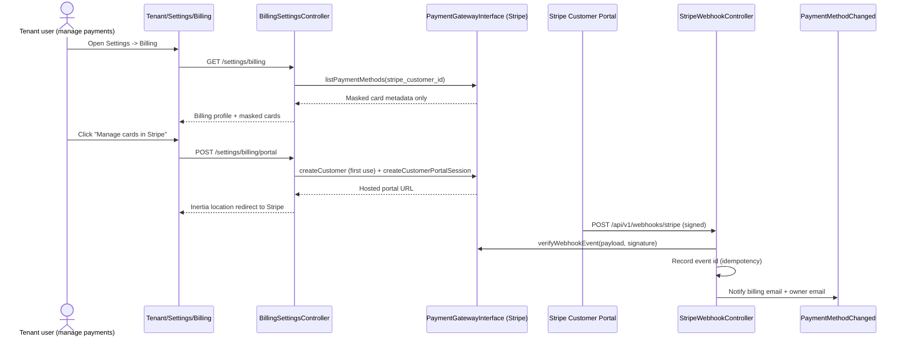

# Billing settings and Stripe card management

## Scope

Covers the tenant-facing Billing settings page, the Stripe Customer Portal
handoff, and the central webhook that sends card-change confirmation emails.
It does **not** cover plan checkout, subscription invoices, or the admin
gateway/API-key configuration screen.

## Flow

## Step-by-step

1. The Billing card appears in the settings hub only for users holding the
   `manage payments` permission; the same permission guards every billing
   route. No new permission was introduced.
2. Billing details are saved on the central `tenants` row. The personal profile
   form still writes to the tenant database user row, so the owner's login
   email is never changed by a billing edit.
3. When a billing email change is saved for a tenant that already has a Stripe
   customer, the adapter updates the Stripe customer email. A failed Stripe
   update returns an error and does not persist the local change.
4. On the first portal visit, the app creates a Stripe customer with tenant
   metadata and stores only its id in `tenants.stripe_customer_id`. No card
   number, expiry, or CVC is ever collected or stored by the app.
5. The portal session URL is short-lived and Stripe-hosted. The return URL is
   generated per request, so it carries the current tenant host.
6. Stripe posts signed `payment_method.attached`, `payment_method.detached`,
   and `customer.updated` events to the central webhook. `customer.updated`
   only produces an email when the default payment method actually changes.
7. The webhook verifies the signature, records the Stripe event id in
   `stripe_webhook_events`, and resolves the tenant by
   `stripe_customer_id`. Retried deliveries are acknowledged without a second
   notification.
8. One on-demand `PaymentMethodChanged` notification is routed to both the
   billing email and the owner email. Its content contains only masked card
   metadata.

## Stripe setup

1. Set `STRIPE_SECRET_KEY` and `STRIPE_WEBHOOK_SECRET` in the environment.
   `STRIPE_WEBHOOK_SECRET` is the signing secret of the endpoint below — not
   the API key.
2. In Stripe Dashboard → Developers → Webhooks, add an endpoint for
   `https://<central-domain>/api/v1/webhooks/stripe` and subscribe to:
   - `payment_method.attached`
   - `payment_method.detached`
   - `customer.updated`
3. Enable the Stripe Customer Portal and allow the tenant domains as return
   destinations. The app supplies `return_url` when it creates each session;
   an allow-listed portal configuration is still required by Stripe.
4. Grant the existing `manage payments` permission to any tenant role that
   should see the Billing card and manage cards.

## Key decisions & invariants

- **Separation of concerns:** user profile data stays in the tenant database;
  company/billing/Stripe metadata stays on the central tenant row.
- **No raw PAN/CVC:** the UI only renders brand, last four digits and expiry
  returned by the gateway. Card entry happens exclusively in Stripe's portal.
- **Explicit sync:** Stripe customer contact details are updated only from the
  billing form, never as a side effect of a personal profile update.
- **Idempotency:** the webhook ledger is durable and central, because webhooks
  arrive outside tenant context.
- **Fail-soft rendering:** if Stripe is unavailable, the Billing page still
  renders the profile and shows a warning instead of a 500.

## Cross-references

- `docs/architecture/03-multi-tenancy.md` — central versus tenant data.
- `docs/architecture/05-permissions-and-plan-gating.md` — `manage payments`.
- `docs/architecture/09-notifications.md` — notification delivery conventions.
